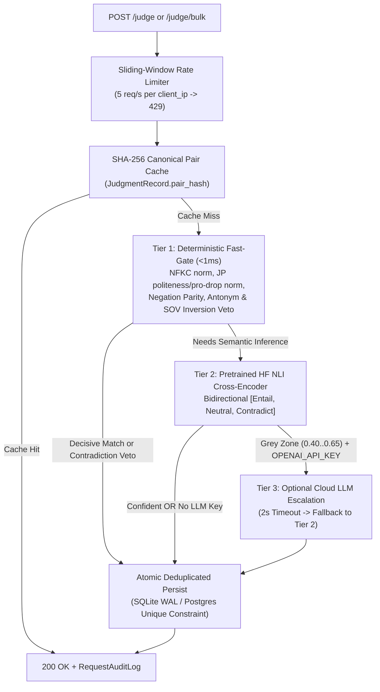
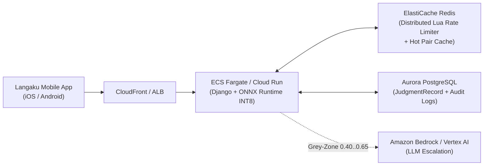

# Same-Language Entailment Judge API

Backend implementation for **Mantra Inc. — Langaku Backend Engineer Coding Assignment (Option 3: Entailment Judge API)**.

Determines whether two sentences written in the same language convey the same meaning (`ENTAIL`) or do not (`NO_ENTAIL`) despite differences in word order, register/politeness, or vocabulary.

---

## 1. Quick Start

### Option A: Docker Compose (Recommended — Zero Manual Model Setup)
The `Dockerfile` pre-caches the HuggingFace NLI Cross-Encoder weights during image build and launches **PostgreSQL 15 + Django/Gunicorn**:

```bash
docker compose up --build
```

The API will be available at `http://localhost:8000` (health check: `GET http://localhost:8000/health`).

### Option B: Local Virtual Environment (`uv` or `venv`)
```bash
# Using uv (matching the assignment template):
uv sync --all-groups
uv run manage.py migrate
uv run manage.py runserver

# Or using Python venv + pip:
python3 -m venv .venv
.venv/bin/pip install -e ".[dev]"
.venv/bin/python manage.py migrate
.venv/bin/python manage.py runserver
```

> **Note on Model Download & Caching:**
> On the first Tier 2 inference call (if not already built via Docker), `transformers` downloads `MoritzLaurer/multilingual-MiniLMv2-L6-mnli-xnli` (~428 MB) once into `~/.cache/huggingface` (`HF_HOME`). Subsequent runs load directly from local disk.
> To override the model (e.g., `MoritzLaurer/mDeBERTa-v3-base-xnli-multilingual-nli-2mil7` or `llm-book/bert-base-japanese-v3-jnli`), set `NLI_MODEL_NAME`. To force offline Tier 1 heuristic mode with zero model weights, set `NLI_ENABLE_MODEL=false`.

### Run Tests & Linter
```bash
# With venv:
.venv/bin/pytest -v
.venv/bin/ruff check .
.venv/bin/ruff format --check .

# With uv / poethepoet:
uv run poe test
uv run poe lint
uv run poe format
```

---

## 2. Algorithm & Architecture (3-Tier Hybrid NLI Pipeline)

Pure bi-encoder cosine similarity (e.g., Word2Vec or embedding cosine distance) frequently conflates **antonyms/contradictions** with entailment because sentences like `"A cat is a carnivore."` and `"A cat is a vegetarian."` share almost identical topic tokens. Conversely, unrelated neutral sentences (`"The Earth orbits the Sun."` vs. `"Humans are capable of thought."`) must stay near `0.0`.

To solve both **semantic paraphrasing** and **logical contradiction traps** under strict latency and concurrency constraints, this service uses a **3-Tier Hybrid Pipeline**:



### Mathematical Formulation (Bidirectional NLI Scoring)

For an unresolved pair $(s_1, s_2)$, the Tier 2 Cross-Encoder (`MoritzLaurer/multilingual-MiniLMv2-L6-mnli-xnli`) runs **forward** $(s_1 \Rightarrow s_2)$ and **reverse** $(s_2 \Rightarrow s_1)$ inference in a single vectorized tensor pass, returning softmax probabilities $(p_E, p_N, p_C)$ summing to $1$ in each direction:

$$p_{E,\text{mean}} = \frac{p_E(s_1 \Rightarrow s_2) + p_E(s_2 \Rightarrow s_1)}{2}, \qquad p_{C,\text{max}} = \max\Big(p_C(s_1 \Rightarrow s_2),\; p_C(s_2 \Rightarrow s_1)\Big)$$

$$\text{score}_{\text{NLI}} = p_{E,\text{mean}} \times \big(1 - p_{C,\text{max}}\big)$$

$$\text{label} = \begin{cases} \text{ENTAIL} & \text{if } \text{score} \ge 0.50 \\ \text{NO\_ENTAIL} & \text{otherwise} \end{cases}$$

- **Why Bidirectional + Contradiction Penalty?**
  - **Paraphrases** (`"私は猫が大好きだ。"` $\leftrightarrow$ `"猫が好きです。"`) have high $p_E$ in both directions and near-zero $p_C$ $\implies \text{score} \ge 0.90$.
  - **One-way hypernyms** (`"I adopted a Siamese cat."` vs. `"I adopted an animal."`) fail reverse entailment ($s_2 \nRightarrow s_1$), keeping the bidirectional score below full equivalence.
  - **Contradictions** (`"A cat is a carnivore."` vs. `"A cat is a vegetarian."`) spike $p_{C,\text{max}} \to 0.93+$, crushing $\text{score} \to <0.05$.
  - **Unrelated neutral pairs** (`"The Earth orbits the Sun."` vs. `"Humans are capable of thought."`) yield $p_N \approx 0.9$, $p_E \approx 0.03 \implies \text{NO\_ENTAIL}$.

### Pseudocode
```python
def judge_batch(pairs):
    cached = db_lookup_by_sha256(pairs)
    unresolved = []
    for pair in uncached(pairs, cached):
        t1 = evaluate_tier1(pair.s1, pair.s2)
        if t1.decisive:
            # Catches exact/register matches (e.g. だ/です, pro-drop)
            # AND hard contradictions (antonyms, negation parity, SOV role swaps)
            results[pair] = (t1.label, t1.score, "tier1_rule")
        else:
            unresolved.append((pair, t1))

    if unresolved:
        # Single vectorized pass of 2*K directional inputs
        nli_scores = cross_encoder_bidirectional_batch(unresolved)
        for (pair, t1), nli in zip(unresolved, nli_scores):
            if 0.40 <= nli.score <= 0.65 and openai_key_configured():
                nli = try_llm_escalation_with_timeout(pair, fallback=nli)
            results[pair] = nli

    persist_idempotently(results)  # Unique pair_hash + atomic retry
    return results
```

### Observed Benchmark (Local CPU, 14-Pair Bilingual/Manga Evaluation Set)

| Engine Mode | 14-Pair Latency | Accuracy | Key Observation |
|---|---:|---:|---|
| **Tier 1 Only** (Deterministic Rules / Fallback) | `0.95 ms` | `64.29%` (9/14) | Ultra-fast offline fallback; misses non-surface idioms (`東京に行った` vs. `東京へ足を運んだ`). |
| **Tier 2 Only** (`multilingual-MiniLMv2-L6` alone) | `153.25 ms` | `92.86%` (13/14) | Strong on idioms & paraphrases, but fooled by Japanese SOV particle swaps (`猫が魚を食べた` vs. `魚が猫を食べた`: `0.9917`). |
| **Hybrid Tier 1 + Tier 2 (Production Default)** | **`80.36 ms`** | **`100.00%`** (14/14) | **47.6% faster** than Tier 2 alone (only 8/14 escalated) AND Tier 1 blocks the SOV role-swap vulnerability. |

- **Single uncached Tier 2 pair latency:** `50.11 ms` on CPU (`<1 ms` on DB cache hit or Tier 1 fast-gate).
- **100-pair `/judge/bulk` worst-case Tier 2 batch latency:** `702.7 ms` on CPU (~7 ms/pair amortized).

---

## 3. Requirements & Evaluation Mapping (F1–F4 & NFRs)

- **F1 (`POST /judge` & `POST /api/v1/judge`):** Validates non-empty strings (`max_length=2000`) and same-language compatibility (`is_same_language_pair`, allowing Japanese text containing ASCII acronyms like `"AI"` while rejecting cross-language pairs such as Japanese vs. English with `400`). Returns `{"label": "ENTAIL" | "NO_ENTAIL", "score": float}`.
- **F2 (`POST /judge/bulk` & `POST /api/v1/judge/bulk`):** Accepts either a JSON array `[{"sentence1": ..., "sentence2": ...}, ...]` or `{"pairs": [...]}` with `1..100` pairs, deduplicates within the batch, executes a single vectorized NLI pass over uncached pairs, and returns an ordered array of results.
- **F3 (`GET /judge/stats` & `POST /judge/evaluate`):** Addresses the Deliverables specification (*"Explanation of how judgment criteria meets requirements F1-F3"* and *"stats accuracy calculation"*). `GET /judge/stats` aggregates judgment counts, label distribution, tier distribution, audit latency, and stored ground-truth accuracy; `POST /judge/evaluate` runs labeled test pairs and computes accuracy, precision, recall, F1, and confusion matrix.
- **F4 (Rate Limiting):** `SlidingWindowRateLimiter` tracks per-`client_ip` (`X-Forwarded-For` or `REMOTE_ADDR`) timestamps in a thread-safe `deque` over a `1.0s` sliding window. Requests beyond **5 req/s** immediately return `429 Too Many Requests` with `Retry-After` and are recorded in `RequestAuditLog`.
- **NFR 1 (Latency vs. Accuracy):** Tier 1 handles trivial register matches and hard contradictions in `<1 ms`; Tier 2 batches remaining pairs cleanly; DB cache short-circuits repeated queries in `<2 ms`.
- **NFR 2 (Concurrent Writes — 30 Parallel Threads):** `JudgmentRecord.pair_hash` stores a `SHA-256` digest of normalized `(s1, s2)` under a `UNIQUE` DB constraint. Writes use `transaction.atomic()` with `get_or_create` + `IntegrityError` handling (plus SQLite WAL mode `PRAGMA journal_mode=WAL; PRAGMA busy_timeout=30000;` and write serialization when running locally on SQLite), verified by a 30-thread parallel pytest stress test producing **0 duplicate rows**.
- **NFR 3 (Security / Auditability):** Every `/judge*` API call persists a `RequestAuditLog` row (`client_ip`, `method`, `path`, `status_code`, `payload_chars`, `latency_ms`, `rate_limited`, `created_at`).

---

## 4. API Endpoints

Full OpenAPI 3.0.3 specification is available in [`openapi.yaml`](openapi.yaml). All `/judge*` endpoints are also mounted under `/api/v1/judge*`.

| Method | Path | Purpose | Rate Limited |
|---|---|---|---|
| `POST` | `/judge` | Single sentence-pair entailment judgment (`F1`) | Yes (5 req/s) |
| `POST` | `/judge/bulk` | Batch judgment for 1–100 pairs (`F2`) | Yes (5 req/s) |
| `GET` | `/judge/stats` | Judgment metrics, tier breakdown & stored accuracy (`F3`) | Yes (5 req/s) |
| `POST` | `/judge/evaluate` | Evaluate labeled pairs & calculate accuracy/precision/recall/F1 (`F3`) | Yes (5 req/s) |
| `GET` | `/health` | Container/load-balancer health check | No |

### Example Request & Response
```bash
curl -X POST http://localhost:8000/judge \
  -H "Content-Type: application/json" \
  -d '{"sentence1": "私は猫が大好きだ。", "sentence2": "猫が好きです。"}'
```
```json
{
  "label": "ENTAIL",
  "score": 0.92
}
```

---

## 5. Production Deployment Architecture at Langaku Scale (AWS / GCP)

While this submission runs cleanly on a single container or local machine, deploying this service for Langaku's production mobile traffic requires horizontal scalability across multiple stateless workers:



1. **Distributed Rate Limiting:** Replace the in-process `deque` in `assignment/rate_limit.py` with an atomic **Redis Lua sliding-window counter** (`ZADD` + `ZREMRANGEBYSCORE` + `ZCARD`) in Amazon ElastiCache so the 5 req/s per-IP quota holds globally across all ECS Fargate / Cloud Run replicas.
2. **CPU Inference Optimization:** Export `multilingual-MiniLMv2` to **INT8-quantized ONNX Runtime** (`optimum`), cutting CPU inference latency ~2–3x and shrinking container image size without paying for idle GPU instances; isolate heavy `/judge/bulk` calls onto an autoscaling worker pool or AWS SageMaker Serverless Inference.
3. **Database & Partitioning:** Run PostgreSQL with `INSERT ... ON CONFLICT (pair_hash) DO NOTHING` for lock-free deduplication and time-partition `RequestAuditLog` by month.

---

## 6. Three Ideas for Future Accuracy Improvements

1. **Fine-Tune on Manga Dialogue & *Yakuwarigo* (役割語) Corpora:**
   General NLI benchmarks (MNLI/XNLI/JNLI) use formal news and encyclopedic prose, underperforming on manga speech styles (`〜だぜ`, `〜なのじゃ`, dropped subjects, colloquial contractions like `〜ちゃう` / `〜てる`). Fine-tuning a Japanese Cross-Encoder (`cl-tohoku/bert-base-japanese-v3` or `mDeBERTa-v3`) on synthetic *yakuwarigo*-to-hyojungo paraphrase pairs mined from Langaku's bilingual manga dataset would substantially boost comprehension quiz accuracy.
2. **Contextual Panel & Speaker Windowing:**
   Manga dialogue heavily relies on omitted subjects (`"行くぞ！"` vs `"一緒に移動しましょう。"`). Passing optional metadata (`speaker_id`, `previous_bubble_text`) into the Cross-Encoder premise context (`"[Prev: 敵が来た] [Speaker: Luffy] 俺が守る！"`) resolves pro-drop ambiguity without inventing a false subject.
3. **Temperature Scaling Calibration + Active Learning Loop:**
   Raw softmax probabilities on cross-encoders tend to be overconfident near `0.0` or `1.0`. Fitting a learned temperature scalar $T$ on a held-out Langaku validation set via `POST /judge/evaluate` makes `score` directly interpretable as true calibrated probability, while routing Tier 3 LLM-escalated disagreements back into a weekly active-learning fine-tuning set.
