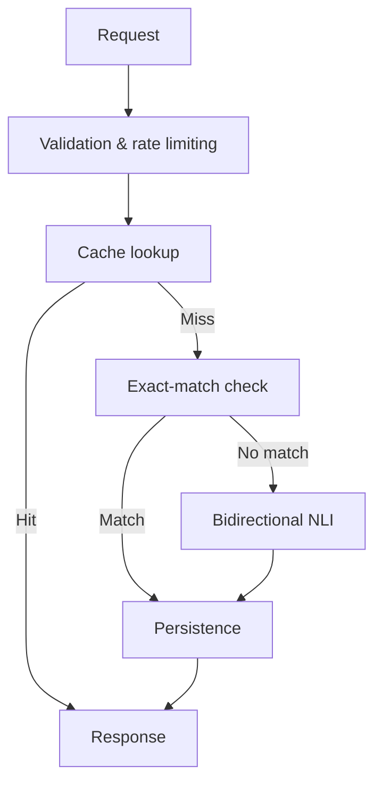

# Sent-Shark: Same-Language Entailment Judge

## Overview

A Django REST Framework service that classifies whether two same-language Japanese (`ja-ja`) or English (`en-en`) sentences convey equivalent meaning (`ENTAIL` or `NO_ENTAIL`).

## Quick Start

Start PostgreSQL 15 and the API server with Docker Compose:

```bash
docker compose up --build
```

The image pre-caches `MoritzLaurer/multilingual-MiniLMv2-L6-mnli-xnli` under `HF_HOME=/app/.cache/huggingface`. Local Python runs download weights on first inference; set `NLI_ENABLE_MODEL=false` for an offline exact-match fallback that enforces character limits without Hugging Face files.

Verify liveness and judge a pair (or open `http://localhost:8000/playground` in a browser):

```bash
curl -s http://localhost:8000/health
curl -s -X POST http://localhost:8000/judge \
  -H "Content-Type: application/json" \
  -d '{"sentence1":"私は猫が大好きだ。",
       "sentence2":"猫が好きです。"}'
```

```json
{"label":"ENTAIL","score":0.921}
```

## API

Full request/response schemas, headers, and error examples are documented in [openapi.yaml](openapi.yaml).

- `POST /judge`: Classify a single `{"sentence1", "sentence2"}` pair.
- `POST /judge/bulk`: Classify `1` to `100` pairs sent as a JSON array or `{"pairs": [...]}`.
- `GET /health` and `GET /playground`: Liveness check and dependency-free browser UI (unthrottled).
- **Input constraints:** Both fields must be strict JSON strings of `<= 2000` characters containing at least one substantive Unicode letter, number, or symbol after `NFKC` normalization, share the same language family (`ja` permits embedded ASCII terms), and fit within `256` combined NLI tokens per direction (no silent truncation; excess length returns HTTP `400`). Bulk requests validate atomically before any persistence, and bodies above `2.5 MiB` return HTTP `413`.
- **Rate limiting:** `/judge` and `/judge/bulk` enforce `5` requests per `1.0s` sliding window per client IP (`429` with `Retry-After` and `X-RateLimit-*` headers). `X-Forwarded-For` is ignored unless `TRUST_PROXY_HEADERS=true` matches `TRUSTED_PROXY_IPS`.

## Approach

Each request flows through the pipeline below:



Normalized identical sentences (after `NFKC`, whitespace collapse, and edge punctuation trimming; case-insensitive for English) short-circuit at `ENTAIL` (`0.99`). Non-identical pairs are scored in both directions with `MoritzLaurer/multilingual-MiniLMv2-L6-mnli-xnli`:

$$
s(A,B) = \min(p_{A\to B}, p_{B\to A})
$$

Here $p_{A\to B}$ and $p_{B\to A}$ denote the cross-encoder entailment probabilities for $A \to B$ and $B \to A$, respectively. A pair is labeled `ENTAIL` when the unrounded minimum score is at least `0.50` (`NO_ENTAIL` otherwise), requiring support in both directions so one-way entailment is rejected without claiming the formula guarantees semantic equivalence.

## Reliability and Testing

Stored judgments are deduplicated in PostgreSQL via a symmetric hash over normalized text and scoring configuration so repeated or reversed pairs are evaluated once. An in-memory LRU cache and singleflight coalescing handle repeated lookups and concurrent cold misses without duplicate writes, while `RequestAuditLog` records every `/judge*` outcome without storing sentence text.

```bash
.venv/bin/pytest -v
.venv/bin/python manage.py run_eval --dataset dev --diagnostics --json
.venv/bin/python manage.py run_eval --dataset dev_diagnostic --diagnostics --json
```

## Accuracy and Limitations

Metrics below measure `exact_plus_nli:v2:min` strictly on two 60-pair development fixtures—curated `dev` (`eval_gauntlet.json`) and `JGLUE JNLI`/`PAWS-X` `dev_diagnostic` (`eval_holdout.json`). They characterize behavior and failure modes and are **not** independent estimates of production generalization accuracy.

| Dataset | Overall | Japanese (`ja`) | English (`en`) |
|---|---|---|---|
| `dev` (60) | `81.7%` (49/60) | `87.5%` (28/32) | `75.0%` (21/28) |
| `dev_diagnostic` (60) | `63.3%` (38/60) | `75.0%` (30/40) | `40.0%` (8/20) |

- **Word-order and particle swaps:** Zero-shot XNLI remains sensitive to lexical overlap, scoring `10.0%` (`1/10`) on `dev_diagnostic` `adversarial_swap` pairs.
- **Borderline paraphrase recall:** Requiring both directions to exceed `0.50` improves directional clarity over averaging with a contradiction penalty, while rejecting paraphrases if one direction dips below threshold.
- **Single-process state:** The in-memory rate limiter and LRU cache protect single-worker deployments; multi-worker horizontal scaling requires shared Redis state.

## Three Future Accuracy Improvements

1. **Japanese linguistic fine-tuning:** Fine-tune on particle-scrambling, role-inversion, and paraphrase-swap examples alongside Japanese NLI corpora (`JSICK`, `JGLUE JNLI`, `PAWS-X`) to counter surface-overlap bias (Yanaka & Mineshima, 2022; Kurihara et al., 2022; Yang et al., 2019).
2. **Context-aware semantic judgment:** Pass surrounding dialogue turns or panel context when judging short lines so Japanese pro-drop (omitted subjects and objects) and ellipsis resolve unambiguously.
3. **Uncertainty-aware escalation:** Route low-confidence or strongly asymmetric pairs (near `0.50` or large $|p_{A\to B} - p_{B\to A}|$) to a stronger model only when justified by an independent evaluation set.
